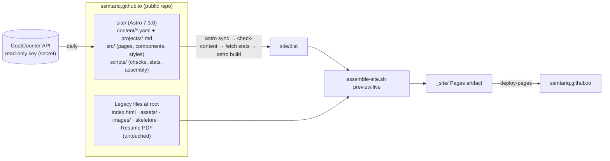

# 04 · Site Design and Implementation Plan

**Site:** `ssmtariq.github.io`. Your CV header already links it, so committees who open the CV land here.
**Goal:** the faculty-market personal site, in maize and blue, built beside your existing site without breaking it.
**Status:** Ready to implement once the six Stage-1 decisions in Section 19 are made. Defaults are given for each, so a "go" with defaults is enough. Everything marked *verified* was tested in the scratch spike; the log is in `06_Verification_and_Readiness.md`.

---

## 0. The plan in one page

- **Build:** Astro 7.3.8 on Node 24.21.0, inside a new `site/` folder in your existing repository. The site is static and data-driven: every fact lives in validated YAML files with a `source` field, and every number on the page cites its paper and page. *(verified)*
- **Look:** a Michigan-blue first screen with maize accents. Your name is set as on your CV (given names light, family name bold maize), with the status line, the job-market chip, and the identity sentence. An animated *Measure → Attribute → Act → Validate* loop around your headshot, a research timeline styled like a trace, and four cited result cards. Light and dark themes pass WCAG AA throughout. *(verified probe: `evidence/probe_*`)*
- **Stands out by:** coherence (one research question across four layers), evidence (results cite pages; certificates and artifacts are one click away), teaching ownership shown honestly, systems-community service (OSDI artifact evaluation), Google Scholar-ready paper pages, measured performance, and a validated data model no peer has.
- **Keeps the existing site:** preview the new site at `/v2/` while the current site stays at `/`. At cutover the new site moves to `/` and the old one to `/classic/`; `/skeleton/` is untouched. Rollback is one variable. *(verified in both modes; legacy pages load with 0 broken assets)*
- **View count with location:** GoatCounter, cookie-free; a daily build turns its country data into a maize/blue world map at `/stats/`. *(verified against a mock API)*
- **Adding things later:** a publication, service role, certification, role, news item, or talk is a few lines of YAML that your editor autocompletes and the build checks. *(verified: 17 of 17 injected mistakes rejected)*
- **Effort:** about 10-11 focused working days across 8 phases (Section 16).

## 1. Goals and measurable success criteria

| ID | Goal | Pass criterion (checked at acceptance, Phase 6) |
| --- | --- | --- |
| G1 | First impression in 30 seconds | At 1440×900 and 390×844, the first screen shows name, Ph.D.-candidate status, institution, expected April 2027, the job-market chip, the identity sentence, and a CV button. No pop-ups and no loader |
| G2 | Rigor | 100% of displayed numbers have a source (checker rule). Every claim is at most one click from its evidence: DOI, artifact, certificate, or evaluation |
| G3 | Teaching legibility | Instructor roles appear before TA roles; every term shows role, size, and modality; the evaluation always shows the response count |
| G4 | Performance | Lighthouse (mobile) ≥ 95 for Performance, Accessibility, Best Practices, and SEO. Home first view ≤ 350 KB compressed, ≤ 25 requests, JavaScript ≤ 35 KB gzipped, LCP ≤ 1.8 s, CLS ≤ 0.05 |
| G5 | Accessibility | WCAG 2.2 AA; axe reports 0 serious or critical issues; fully keyboard-operable; motion respects reduced motion |
| G6 | Maintainability | A new news item takes 2 minutes or less (copy a template, edit, push). Content errors fail CI with a file, entry, and message |
| G7 | Analytics | Footer shows visitors and countries "since ⟨launch⟩"; `/stats/` map updated daily; privacy note present |
| G8 | Coexistence | Legacy home and skeleton reachable after cutover; rollback in under 5 minutes; no old URL turns into a 404 |

## 2. Audience and first-impression strategy

| Reader | What they need in 30 s | What they need in 3 min | Where on the site |
| --- | --- | --- | --- |
| Research-forward committee member (R1/R2) | Identity, a coherent program, venues, first-author roles | Project depth, artifacts, the independent next step | Home hero, research map, Research and project pages, Publications |
| Teaching-focused committee member | Instructor-of-record evidence, courses, modality | Philosophy, evaluation with context, mentoring outcomes, prepared-to-teach areas | Home teaching card, Teaching page |
| Students and collaborators | What you work on, how to reach you | Papers, code, datasets | Research, Publications, footer contact |

**Rule from your CV workflow:** the site must say exactly what the CV says. It may say less, and it may give more context, but never different facts.

## 3. Copy deck (every line traceable)

| Slot | Text | Source |
| --- | --- | --- |
| Status | Ph.D. Candidate · University of Michigan-Dearborn | CV final header; C0 decision 1 |
| Meta line | Advisor: Dr. Probir Roy · Expected April 2027 | C0 decision 1; CV final |
| Chip | On the 2026–27 faculty job market | Your target (AGENTS.md); switches off automatically after `job_market.until` |
| Identity | "I build developer-facing analysis tools and empirical methods that find, attribute, and fix performance inefficiencies in cloud and distributed software." | Research notes Section 5, candidate 1 (your choice, D16); wording matches the AGENTS.md profile anchor |
| Thesis (Research page lead) | Verbatim PROP p.8: "Cross-layer performance regressions in cloud systems create an observability gap … across application, runtime, and configuration layers." | PROP p.8 (rule 6 allows it) |
| Method | Measure → Attribute → Act → Validate | PROP p.8, p.48 |
| Results at a glance | 4.59× (MicroProf, TACO '23 p.14 Table 1) · 2.30× (SlimStart, ICDCS '25 p.1) · 64% less diagnostic effort (INITSCOPE, SANER '26 p.1) · 335,103 commits (PerfMiner, EASE '26 p.1) | Project seeds (each carries its locator) |
| AI paragraph (Research page) | "AI is part of how I do this work, not its subject. PerfMiner (EASE 2026) uses LLM-guided labeling and knowledge distillation; our SANER 2026 study used an open-weight LLM to triage issue reports, with manual validation; and my ongoing dissertation work on configuration tuning evaluates LLM-guided tuners and uses LLM reasoning over profiling evidence, with guardrails. I plan to use AI to extend this research further." | C0 decision 8; 02B item 9(a); critique row 9 wording. No proposal numbers (rule 6) |
| Teaching snapshot | "Instructor of record for CIS-200 Computer Science II (Summer 2024; sole instructor, no TA); lab instructor for CIS-200L (Fall 2024, Fall 2026) and the ESIEA exchange program (Summer 2023); teaching assistant in Operating Systems, Advanced Operating Systems, and Computational Learning across seven terms, with classes of up to 62 students and online asynchronous sections." | C0 teaching table; 02B items 3, 4, 15, 18.3 |
| Service snapshot | "Artifact Evaluation Committee, USENIX OSDI 2024 and 2025 and JSys 2026 · sub-reviewer, IEEE TCC and ACM TACO · President, ACM Student Chapter at UM-Dearborn (2025–)" | CV final; 02B item 8 |
| Mentoring line | "Co-advised three M.S. students and one undergraduate; all four co-authored the resulting work (IEEE ICDCS 2025; SC24 poster)." | 02B item 7; CV final. Mentees' genders are left off the public site to protect their privacy; keep that detail in your statements |
| Industry bridge | "More than six years as a Java/Spring Boot backend and integration engineer (BRAC IT Services, BJIT) before the Ph.D." | AGENTS.md anchor; CV final |
| Teaching philosophy (three pillars) | Hands-on projects tied to professional practice; transparent, ethical use of generative AI with explain-your-work assessment; inclusive classes with clear expectations and multiple office-hour channels | Your final teaching statement (2026-10-23), as approach text only. Its numeric claims not found in primary sources stay off |

## 4. Information architecture

```
/                       Home: 30-second page
/research/              Program, thesis, research map, trace, AI paragraph, directions (if you approve them)
/research/<project>/    microprof · slimstart · cold-start-study · perfminer · perffinder (no numbers)
/publications/          Explorer: filters, search, BibTeX; "Earlier publications" collapsed at the end
/publications/<id>/     One paper per URL: abstract, authors, Google Scholar tags, PDF/DOI/artifact/talk, BibTeX
/teaching/              Philosophy · record · evidence · mentoring · prepared to teach · online/hybrid · guest lecture
/service/               Artifact evaluation · reviewing · leadership · memberships
/talks/                 Talks and posters you presented (earlier ones collapsed)
/news/                  Dated archive + /news/rss.xml
/about/                 Bio · education · experience timeline · honors and grants · selected certifications · skills · technical writing
/cv/                    CV hub: HTML summary + PDF + "updated" date (also /cv.pdf)
/stats/                 Visitors and countries map, privacy note
/classic/ , /skeleton/  Legacy sites, preserved
/404.html, /sitemap-index.xml, /robots.txt, /publications.bib
```

**Nav:** Research · Publications · Teaching · Service · Talks · News · About · **CV** (maize button). On phones: a menu button opens a drawer.

## 5. Page specifications

Each page is generated from the collections named. Acceptance criteria are tested in Phase 6.

**Home** (`profile`, `projects.results[featured]`, `publications[selected]`, `teaching`, `service`, `news`)

1. **Hero:** status chip, job-market chip, name, identity sentence, meta line, CTAs (Download CV · Research · Teaching · email), the loop around the headshot, and the research trace.
2. **Results at a glance:** four featured results, each with its paper and locator.
3. **Research map teaser,** linking to Research.
4. **Selected publications:** up to 4, with teaser figures.
5. **Teaching card:** instructor-of-record evidence plus counts.
6. **Service strip.**
7. **Latest news:** 5 items, with a "new" badge for 45 days.

*Accept:* G1; no earlier publications; the print view fits one page.

**Research** (`projects`, PROP text)

- Thesis statement, the loop, the four-layer research map with PerfMiner shown "beyond the dissertation", and the trace timeline.
- AI paragraph, then directions: hidden until you approve them from research notes Section 6.

*Accept:* every project links to its page; no proposal numbers.

**Project pages** (`projects/*.md`)

Problem, approach (with a figure and its credit), cited results, artifacts, publications, your role, and a funding acknowledgment for work the papers credit to NSF award CNS-2006373. That award funded the research; it is never shown as a personal award.

*Accept:* the PerfFinder page shows no numbers (checker rule).

**Publications** (`publications`, `people`, `venues`)

- Groups: Conference papers · Journal articles · Posters · Manuscripts in preparation · *Earlier publications* (collapsed).
- Filters: category, topic, role, year. Search covers title, authors, and abstract.
- Each entry shows your name highlighted, `*` for equal contribution, status chip, DOI, PDF, BibTeX, artifact, and talk.
- A `/publications.bib` file is generated from the same data.

*Accept:* works without JavaScript (the full grouped list renders); filters are reflected in the URL.

**Paper pages**

- Title, authors, venue in full, abstract, figure, and links.
- Google Scholar tags: `citation_title`, `citation_author` (one per author), `citation_publication_date`, `citation_conference_title` or `citation_journal_title`, `citation_volume`/`issue`/`firstpage`/`lastpage` when known, `citation_doi`, and `citation_pdf_url` when the PDF is hosted beside the page.
- JSON-LD `ScholarlyArticle`; IEEE notice when an accepted version is hosted.

*Accept:* tags validate; any self-hosted PDF is ≤ 5 MB.

**Teaching** (`teaching`, `mentoring`, `talks[guest-lecture]`)

- Philosophy (three pillars), then the record table grouped by role: instructor roles first, each with term chips, class size, modality icons, and responsibilities.
- An evidence card for CIS-200: 4.75/5 against a department mean of 4.51, with "4 of 15 students responded" always shown, and a link to the report if you approve (D5).
- Mentoring with outcomes, prepared-to-teach areas (generic), online and hybrid experience, and the guest lecture.

*Accept:* G3.

**Service** (`service`)

Grouped as: Artifact evaluation · Reviewing · Leadership and outreach · Memberships.

*Accept:* venue names spelled out.

**Talks** (`talks`)

Talk cards with event, location, date, and slides/video buttons when you add the links. Earlier talks are collapsed.

**News** (`news`)

Dated list (only the precision the source gives), kind icons, links to the related paper, talk, or award, and an RSS feed.

**About** (`education`, `experience`, `awards`, `certifications`, `skills`, `writing`)

- Bio, then education: dissertation, committee, and honors; **no GPAs**.
- Timeline: academic and industry, at most 4 bullets each.
- Honors and travel grants, with certificates in a lightbox.
- Research-ethics and technical certifications marked `show: true`.
- Skills (compact), and "Technical writing" (the three TariqNotes tutorials).

**CV** (`materials`)

Short HTML summary, a direct PDF download (the web variant, D3), and the "updated" date. `/cv.pdf` also serves the current CV, which fixes today's 404 from `/skeleton/`.

**Stats** (`src/data/visitors.json`)

Totals, a country map with dots, a top-10 table, "since" date, "updated" time, and the privacy note. It hides gracefully when data is unavailable.

**404:** search box and links.

## 6. Design system (maize and blue)

**Tokens.** Values are taken from the verified probe. Every text pairing was computed against WCAG 2.x.

| Role | Light | Dark | Notes |
| --- | --- | --- | --- |
| Michigan Blue / hero background | `#00274C` | hero `#0A2A4F` | Official blue (Michigan Medicine brand guide) |
| Michigan Maize | `#FFCB05` | `#FFCB05` | Fills and accents only; **never as text on white (1.52:1)** |
| Deep maize (text on light) | `#7A5C00` (5.99:1 on paper) | — | Labels and kickers |
| Paper / surface | `#FBFAF6` / `#FFFFFF` | `#061223` / `#0B1C33` | Warm off-white in light; deep navy in dark |
| Ink / muted | `#0E1A2B` (16.74:1) / `#4A5A6E` (6.75:1) | `#E6EDF5` (15.91:1) / `#AEB9C7` (9.44:1) | |
| Link | `#1D4E80` (8.19:1) | `#9FC3F0` (10.32:1) | |
| On-blue text | `#FFFFFF` (15.06:1), `#C9D7EA` (10.32:1), maize (9.89:1) | same | |
| Buttons | Blue on maize (9.89:1) | same | Primary CTA |
| Map scale | `#E6EDF5` → `#C9D7EA` → `#9FB7D6` → `#5583B5` → `#1D4E80` → `#00274C`, maize dots | dark variants | Sequential, color-blind safe (one hue) |

- **Proportion.** About 80% blue and neutrals, 20% maize (Michigan Medicine guidance).
- **Typography.** Self-hosted *Source Serif 4* (display, headings), *IBM Plex Sans* (body, UI), *IBM Plex Mono* (numbers, labels, metadata). Plex's engineered character suits systems work and stays distinct from the reference's Fraunces/Inter. The name is set like your CV: given names light, family name bold.
- **Scale.** 17 px body at 1.6 line height; display uses `clamp(38px, 5.4vw, 66px)`; 1,180 px max width; gutters `clamp(16px, 4vw, 48px)`.
- **Components.** Chip, Button (maize/ghost/link), Card, ResultCard, PaperCard, CourseCard, TimelineItem, StatusPill, MapQuadrant, Lightbox (`<dialog>`), Drawer nav, Footer stats.
- **Focus and motion.**
  - Focus: a 3 px maize ring on blue, a blue ring on light surfaces.
  - Motion is slow and meaningful: the loop packet, hover tints, cross-page view transitions in CSS. `prefers-reduced-motion` removes all of it, and content is visible without JavaScript (the reference's D9 is avoided).
- **Print.** Home prints as a one-page research summary; other pages print cleanly, with link URLs shown.
- **Brand care.** The site is personal, not official. No Block M as the site logo; the monogram is "ST" on maize. The UM-Dearborn logo appears only as an affiliation marker in the timeline.

## 7. Signature UI features (rich, but each one carries information)

| # | Feature | Behavior | Accessibility and performance | Status |
| --- | --- | --- | --- | --- |
| SF1 | Observability-loop hero | Your method as a ring of 4 nodes; a maize packet travels the loop | SVG with SMIL animation, no JavaScript; hidden for reduced motion; `aria-label` names the loop | *Verified in probe* |
| SF2 | Research trace timeline | Projects drawn as spans on a 2022-2027 axis, like a profiler trace; current work in maize | Generated from `projects.years`; a text list for screen readers; collapses on phones | *Verified* |
| SF3 | Results at a glance | Four cards with big numbers and paper/page source | Final numbers are in the HTML; count-up is optional and respects reduced motion | *Verified* |
| SF4 | Cross-layer research map | 2×2 layers around a maize "Performance observability" hub; hover and focus tint; links to projects | Keyboard-focusable; stacks on phones | *Verified* |
| SF5 | Paper cards with real figures | Cropped figures from your papers, credited | AVIF/WebP, 11-28 KB | *Verified (MicroProf Fig. 3)* |
| SF6 | Teaching evidence bars | You vs. department mean, response count always shown | `role="img"` with a full text label | *Verified* |
| SF7 | Visitor world map and footer stats | Country choropleth with proportional dots, top-10 table | Static SVG (40.6 KiB gzipped); `<title>` on every shape | *Verified (mock data)* |
| SF8 | Dark mode | System default plus a toggle; no flash | Token-based; all pairs AA | *Verified* |
| SF9 | Publication explorer | Instant filters (category, topic, role, year), search, URL state, Copy BibTeX with a toast | Works without JavaScript; small JavaScript island ≤ 10 KB | Phase 5 |
| SF10 | Command palette (Ctrl/⌘+K) | Site-wide search (Pagefind) | Lazy-loaded; focus trap; Escape closes | Phase 5 |
| SF11 | Evidence lightbox | "View certificate" opens the certificate with caption and source | Native `<dialog>`, focus return | Phase 5 |
| SF12 | Cross-page view transitions | Smooth page-to-page morphs | CSS `@view-transition`, no JavaScript; browsers without support simply navigate | Phase 5 |
| SF13 | Share cards | Polished Open Graph image site-wide; per-paper cards use the paper's figure | Static images | Phase 5 |
| SF14 | Print-to-summary | Home prints as a one-page research summary | CSS only | Phase 5 |
| SF15 | Self-expiring badges | "New" news badge (45 days); job-market chip ends on its date | Computed at build; the daily build refreshes them | Phase 5 |
| SF16 | Copy-email button | Address assembled in the browser; plain-text fallback | No mailto scraping | Phase 5 |

## 8. Images and assets (from your resources)

| Asset | Source | Processing | Use | Credit / rule |
| --- | --- | --- | --- | --- |
| Headshot | `ssmtariq.github.io/images/ssmtariq-profile.jpg` (1493², studio) | Re-encode without EXIF; Astro `<Picture>` AVIF/WebP at 240/480 px **with an explicit width so the JPEG fallback is resized too** | Hero, OG card | Yours |
| MicroProf architecture | P-MP p.11, Fig. 3 | `tools/crop_figure.py` (caption-anchored) | Paper card, project page | "Figure 3, Tariq et al., ACM TACO 2023 (open access)" |
| MicroProf latency CDFs | P-MP p.15, Fig. 4 | crop | Project results | same |
| SlimStart workflow / library-init share | P-SS p.4 Fig. 4; p.2 Fig. 1 | crop, `--column left` | Project page | "From Tariq et al., IEEE ICDCS 2025 (arXiv version)" |
| Cold-start workflow / taxonomy | P-CS p.3 Fig. 1; p.6 Fig. 2 | crop, `--column left --top 40` (verified) | Paper card, project page | "© 2026 IEEE. From Tariq et al., SANER 2026" |
| PerfMiner pipeline / themes | P-PM p.3 Fig. 1; p.9 Fig. 4 | crop | Project page | "From Azad et al., EASE 2026" |
| Research map and loop | PROP pp.8-9 | Redrawn as SVG in site tokens, not screenshots | Hero, Research | Your slides |
| Certificates (4) | `achievements/`: HM_Originality_2022CPSIoT.pdf, CECS_Certificate…2021-2022.jpg, RakutenCertificate….pdf, BSTF_Travel_Grant.png | Render PDF page 1; straighten and crop; ≤ 1600 px; strip metadata | Lightbox evidence | Yours |
| Logos (4) | `images/logos/*` | Normalize to 96 px PNG/WebP | Timeline markers | Affiliation markers only |
| Blog thumbnails (3) | `images/*.PNG` | WebP, 640 px | "Technical writing" | Yours |
| CV (web variant) | `cv-materials/final/balanced/…` → web variant (D3) | Copy to `public/cv/` and `/cv.pdf` | CV hub | — |
| CIS-200 evaluation report | `course_evaluation/cis200.pdf` | Only if D5 = yes | Teaching evidence | — |
| **Not used** | `banner.jpeg` (Seattle marina, **GPS EXIF 47°36′N 122°20′W**), `Guest_Lecture_Announcement.pdf` (internal Canvas screenshot), routine compliance certificates, PROP pp.42-43 and 48 (preliminary results) | — | — | Privacy; rule 6 |

**Asset rules, enforced by checks:** no EXIF GPS in any image; `alt` text of at least 5 characters (schema); no source image over 300 KB after processing; self-hosted PDFs ≤ 5 MB (Google Scholar limit); every referenced path must exist (checker R10).

## 9. Architecture

> **Update, 2026-10-24.** At your request, the source now lives in the private repository `Personal_site`, and the public repository receives only built files. The current architecture, rollout, and steps are in `08_Launch_Guide.md`. What follows is the original plan; the preview at `/v2/` and the `SITE_MODE` switch are unchanged.



**Repository layout.** Additions only; nothing existing moves or is deleted.

```
site/
  .nvmrc                      24.21.0
  package.json, package-lock.json   exact pins (Section 5 of 03)
  astro.config.mjs            base from SITE_BASE (/v2/ or /)
  content/                    *.yaml collections + projects/*.md   ← you edit only here
  src/content.config.ts       schemas (copy of spike/src/content.config.ts, extended)
  src/assets/                 headshot, figures, certificates, logos (optimized at build)
  src/components/, src/layouts/, src/pages/, src/styles/tokens.css
  src/data/visitors.json      written by the stats fetcher at build (not committed)
  public/                     cv/, cv.pdf, publications/<id>/paper.pdf (if allowed), og/, robots.txt
  scripts/                    check-content.mjs, fetch-visitor-stats.mjs, render-visitor-map.mjs,
                              assemble-site.sh, crop-figures.py, figure-manifest.yaml
  lighthouserc.cjs            budgets per mode
.github/workflows/            deploy.yml, links.yml   (lint-clean copies in spike/.github/workflows)
```

**Local setup (no admin rights needed).** Download `node-v24.21.0-linux-x64.tar.xz` from nodejs.org, check its SHA-256 against `SHASUMS256.txt`, and extract it to `~/.local/node-24`. Add its `bin` to `PATH`, then run `cd site && npm ci && npm run dev`. *(This exact procedure was used for the spike.)*

**npm scripts:**

| Script | Runs |
| --- | --- |
| `dev` | `astro dev` |
| `check` | `astro sync`, then fail on `[ERROR]`, then `node scripts/check-content.mjs` |
| `stats` | the stats fetcher |
| `build` | `astro build` |
| `preview` | `astro preview` |
| `figures` | `python3 scripts/crop-figures.py scripts/figure-manifest.yaml` |
| `new` | a scaffold helper, Phase 5 |

## 10. Keeping the existing site: staged rollout

> **Update, 2026-10-24.** At your request, the source now lives in the private repository `Personal_site`, and the public repository receives only built files. The current architecture, rollout, and steps are in `08_Launch_Guide.md`. What follows is the original plan, with two changes: at cutover the old pages are retired (they redirect to `/` and stay in `legacy/`), and the old résumé URL serves the web CV from the preview onward.

| Stage | What happens | Visitors see | Exit check |
| --- | --- | --- | --- |
| 0 Safety | Tag the current commit `legacy-2026-10-24`. No files moved or deleted | Old site, unchanged | Tag pushed (by you) |
| 1 Preview | Add `site/` and the workflows; set repository variable `SITE_MODE=preview`; switch Pages source to **GitHub Actions** (your action A1) | `/` old site, byte-identical; `/v2/` new site with `noindex` | CI compares checksums of the legacy files in the artifact against the repo |
| 2 Build-out | Phases 1-6 on `/v2/`; share `/v2/` privately (for example with Dr. Roy) | Same as Stage 1 | Acceptance (Section 14) |
| 3 Cutover | Set `SITE_MODE=live` and re-run the workflow | `/` new site · `/classic/` old home · `/skeleton/` unchanged · `/v2/*` redirect to the new paths for 6 months | Live smoke test (legacy pages: 0 broken assets, as in the spike) |
| 4 After launch | Set `STATS_START` to the launch hour; quarterly runbook | — | — |

**Rollback.** Set `SITE_MODE=preview` and re-run the workflow (about 3 minutes). Or switch the Pages source back to "Deploy from branch: main / root" (instant); the legacy files never moved.

**URL preservation.**

| URL | Preview | Live |
| --- | --- | --- |
| `/`, `/index.html` | Legacy home | New home |
| `/skeleton/` | Legacy skeleton | Legacy skeleton (its `../images/` and `../cv.pdf` links now both work) |
| `/images/*` | Legacy | Legacy (path reserved; the new site never writes here) |
| `/Resume_of_SSM_TARIQ.pdf` | Unchanged | Unchanged (D9) |
| `/cv.pdf` | — (404 today) | **Current CV** |
| `/classic/` | — | Legacy home with its own `assets/` and `images/` copies |
| `/v2/*` | New site | Redirect stubs (meta refresh plus canonical) |
| `README.md`, `content/site.json` | No longer published (they are public today) | No longer published |

## 11. Data input format (summary; full specification in `05`)

- **One file per collection** under `site/content/`: `profile`, `site`, `people`, `venues`, `publications`, `talks`, `news`, `teaching`, `mentoring`, `service`, `experience`, `education`, `awards`, `certifications`, `skills`, `writing`, `materials` (YAML arrays), plus `projects/*.md`.
- **Every entry has** a stable kebab-case `id` and a `source` field naming where the fact came from (never shown on the site). `hidden: true` keeps an entry without showing it; `notes` holds working notes.
- **Four layers of checking:**
  1. **Editor:** a YAML schema line at the top of each file gives autocompletion and red underlines, using schemas Astro generates in `.astro/collections/`. *(verified)*
  2. **Schemas:** types, enums, date formats, required fields, and per-entry policies (earlier papers can't be featured; manuscripts can't have a venue or DOI; every number needs a source; the evaluation's responses can't exceed enrollment).
  3. **Integrity checker** (`check-content.mjs`, 16 rules): cross-file references, your author position matching your stated role, at most 4 featured papers, no earlier paper in news, wording guardrails (AI and venue-rank phrases), no `[VERIFY]` in shown fields, no numbers on in-preparation work, missing assets, staleness warnings (for example "EASE still 'accepted' 133 days after the conference").
  4. **CI** fails the deploy on any error, and on any `[ERROR]` line that `astro sync` prints but doesn't fail on (found during verification).

## 12. View count and visitor location

1. **Count.** The self-hosted GoatCounter `count.js` (pinned copy) sends a cookie-free hit. In your GoatCounter settings, enable "Allow adding visitor counts on your website" (A3).
2. **Totals and countries.** `fetch-visitor-stats.mjs` runs in the daily and on-push builds. It calls `/api/v0/stats/total` and the paginated `/api/v0/stats/locations` with `start = STATS_START`, because the API's default window is only one week. It sends the read-only key from the `GOATCOUNTER_TOKEN` secret and writes `src/data/visitors.json`. On any failure it keeps the previous file or writes `available: false`; it never fails the build. *(verified: valid token, no token, and wrong token)*
3. **Display.** Footer: "⟨N⟩ visitors from ⟨M⟩ countries since ⟨month year⟩". `/stats/`: map, top-10 table, "updated" time. The key never reaches the browser, and the map ships no JavaScript.
4. **Honesty.** Counts are labeled as lower bounds ("at least"), because some ad blockers block counters. Country-level only in public; regions stay in your private dashboard.
5. **Privacy note (draft for `/stats/`):** "This site counts visits with GoatCounter, without cookies. It publishes only totals and country-level counts. No personal data is shared with third parties for advertising."

*Confirm the wording against GoatCounter's privacy page at setup.*

## 13. SEO, Google Scholar, and sharing

- **Per page:** unique `<title>` ("⟨Page⟩ · Syed Salauddin Mohammad Tariq") and description from data; canonical URL; Open Graph and Twitter cards; `lang="en"`.
- **Keep your existing** `google-site-verification` token (`MQokU0bg8p567LYVTHLxjKeLQbCxHRp6FvPOqFvJJXA`), so Search Console stays verified.
- **JSON-LD:** `Person` on the home page (affiliation, alumniOf, `knowsAbout` from your research areas, `sameAs` for Scholar, GitHub, LinkedIn, and ORCID once you have it). `ScholarlyArticle` on each paper page. `BreadcrumbList` everywhere.
- **Google Scholar:** Highwire `citation_*` tags on each paper page (Section 5). Hosted PDFs sit beside their page as `/publications/<id>/paper.pdf`, only where publisher policy allows: the SANER accepted version with the IEEE notice. MicroProf and PerfMiner link the open-access ACM DOI; SlimStart links arXiv.
- **Files:** `sitemap-index.xml`, `robots.txt`, `/news/rss.xml`, `/publications.bib`. During preview, `/v2/` carries `noindex`.

## 14. Budgets and quality gates (CI)

| Gate | Tool | Threshold |
| --- | --- | --- |
| Content | `astro sync` (fail on `[ERROR]`), `check-content.mjs` | 0 errors (warnings listed, not failing) |
| Lighthouse (mobile preset) on Home, Research, Publications, a paper page, Teaching | @lhci/cli 0.15.1 | ≥ 0.95 in all four categories; LCP ≤ 1,800 ms; CLS ≤ 0.05; total bytes ≤ 350 KB (Home) |
| Accessibility | axe-core (pa11y-ci or @axe-core/cli) | 0 serious or critical |
| Links | lychee (weekly) | 0 broken |
| Legacy integrity (preview mode) | checksum comparison | identical |
| Workflow syntax | actionlint 1.7.12 | 0 problems |

The probe measured 8 requests and 177 KiB uncompressed on a local server, so the home budget leaves headroom.

## 15. Weaknesses: what the site avoids, and why

You asked to be told. Each item has evidence, the treatment, and the justification. Items marked **D#** need your decision (Section 19).

| # | Weakness | Evidence | Treatment on the site | Justification |
| --- | --- | --- | --- | --- |
| W1 | Thin teaching-evaluation evidence: one survey, 4 of 15 responding | `course_evaluation/cis200.pdf` p.1; critique row 7 | Shown on the Teaching page, not as a hero number; response count always visible; paired with ownership evidence (sole instructor, no TA, designed slides; 11 terms; online asynchronous; mentoring outcomes). Add Fall 2026 CIS-200L feedback when you have it | Teaching-focused committees weigh evidence; your rule requires the response count (02B item 5); honesty protects credibility |
| W2 | No first-author paper yet at a flagship systems/SE venue | critique row 8 | No venue ranks or acceptance rates anywhere (**D2**). Lead with problems, results, artifacts, and the cross-layer program; OSDI artifact evaluation shows trust from the systems community | Committees discount impact-factor substitution (Cornell guidance in deliverable 04); ranks invite the comparison you want to avoid |
| W3 | Advisor on every current-line paper (independence question) | critique row 8; deliverable 04 §5B | A "My role" line per project using only CV-supported verbs; collaborators at Wayne State, Concordia, and UC Merced visible in author lists; your first-author manuscript line (PerfFinder) shown honestly. **No co-author network graph** (it would put your advisor at the center) | Berkeley and UCSF independence signals |
| W4 | No fellowship or external funding (Rackham pending) | 02B item 11 | No "Grants" heading that implies funding; travel grants labeled as such; the schema has no "pending" state | 02B item 11 |
| W5 | Undergraduate GPA 3.37 | final CV | **No GPAs anywhere**: the schema pins `showGpa: false`. "Graduated with High Distinction" shown for the M.S. | critique PD-2; peers who list GPAs read as junior |
| W6 | NIW-style metrics (IF 1.8, Q2, CORE ranks) | CV final | Stored but hidden (**D2**, default off) | deliverables 03 and 04; critique Section 3 |
| W7 | 2014/2017 papers outside the research line | C0 decision 7 | Collapsed "Earlier publications" only; the checker blocks them from news and featured lists | C0 decision 7 |
| W8 | AI overclaim risk | C0 decision 8 | Three-tier paragraph (Section 3); checker bans "AI-powered", "AI researcher", "AI-native", "cutting-edge AI" | deliverable 06 §6 |
| W9 | PerfFinder not yet submitted | C0 decision 2 | "In preparation", no numbers, no venue badge (checker) | critique row 2; research notes 2.5 |
| W10 | EASE 2026 still "Accepted" 4 months after the conference | 02B R1 | Checker warns; find the DOI in the (now open-access) ACM DL and update one line | critique row 17 |
| W11 | Industry section longer than research entries | critique row 15 | At most 4 bullets per role on About; industry framed as a teaching asset on Teaching. **Your wording is kept**, including "the world's largest NGO" (you marked row 15 N) | deliverable 04 §5D |
| W12 | Co-author result claimed as your own act | critique row 5 | PerfMiner contribution reads "the study analyzed …" | critique row 5 |
| W13 | Personal data | final CV; banner EXIF | No phone, home address, referee emails, or mentees' genders; EXIF stripped; marina banner not used. **D3**: web CV variant without phone and references | Privacy; the reference publishes referee emails |
| W14 | CECS certificate praises "teaching" but predates your first teaching term | critique Section 2 | Listed as recognition, never as teaching evidence | critique Section 2 |
| W15 | Outdated public materials (2023 résumé, "graduate student", "Software Engineer & Researcher", earlier papers prominent) | live site | Replaced at cutover; staleness warnings keep it current | Your CV header links this site |
| W16 | Teaching statement tailored to one institution (course numbers, "your department") | `ts/teaching_statement.md` | Not published (**D7**); philosophy shown as site text | Prevents revealing tailoring to other schools |

## 16. Implementation phases

| Phase | Work | Deliverable and acceptance | Days |
| --- | --- | --- | --- |
| P0 Setup and safety | Tag legacy; create `site/` from `spike/`; workflows; repository variables; Pages source switch (A1, A2) | Preview deploy: legacy byte-identical at `/`, placeholder at `/v2/`; rollback rehearsed | 0.5 |
| P1 Content | Finalize schemas; import the seeds; resolve `[VERIFY]` items; CI checks; move the negative tests into `site/tests/` | `npm run check`: 0 errors; negative suite 17/17 | 1 |
| P2 Assets | Figure manifest and 8 crops; certificates; logos; headshot; OG image; web CV (D3); evaluation PDF (D5) | Asset checker: 0 missing; no EXIF GPS; size budgets met | 1 |
| P3 Design system | Tokens, fonts, header with drawer, footer, theme without flash, focus, print; components | axe contrast passes; keyboard walkthrough | 1.5 |
| P4 Pages | All pages in Section 5, including the Google Scholar tags | Each page's acceptance in Section 5 | 3 |
| P5 Signature features | SF1-SF16 | Feature table status all "done"; budgets hold | 2 |
| P6 QA and acceptance | Lighthouse CI, axe, links, Chromium/Firefox/WebKit, phones; re-run the peer capture rig on `/v2/` and fill the scorecard with measured values; fact audit; proofreading | Section 1 goals G1-G8 pass; scorecard in `06` re-measured | 1 |
| P7 Cutover | `SITE_MODE=live`; smoke test; `STATS_START`; Search Console sitemap | Live checks pass | 0.5 |

**Shortcut if a deadline is near:** ship P0-P4 with Home, Research, Publications, Teaching, and CV only (about 5 days), then add the rest.

## 17. Risks

| Risk | Mitigation |
| --- | --- |
| Committees see the old site during the build | Prioritize the shortcut above. Optionally (D15), a 10-minute text patch to the legacy About and résumé link |
| Astro major-version churn (two majors in 2026) | Exact pins and a lockfile; no automatic upgrades; static output keeps working |
| Counter blocked or the API down | Lower-bound label; keep last good data; hide the map when unavailable |
| Figure rights | Only your own papers; credits; publisher policies (`03` Section 4) |
| CV and site drifting apart | Seeds come from the final CV; a quarterly sync checklist (Section 18); the `source` field makes audits fast |
| Secret exposure | Read-only key, used only in the build step; never sent to the client |
| Accessibility or performance regressions | CI gates (Section 14) |

## 18. Maintenance runbook

| When | Do (details and templates in `05`) |
| --- | --- |
| A paper is accepted | Add one `publications` entry (`status: accepted`), a `news` item, and a project link |
| It gets a DOI | Set `doi`, `status: published`, pages; the checker's staleness warning clears |
| You give a talk | `talks` entry (`presented_by_me: true`) plus slides or video links; optional news |
| A new service role | `service` entry (category, role, organization, years) |
| A new course term | `teaching` entry; add `evaluation` when the report arrives (`responses` and `enrolled` required) |
| An award | `awards` entry plus the certificate image in `src/assets/evidence/`; optional news |
| A new certificate | `certifications` entry with `show: true` only if it signals research or teaching |
| CV updated | Replace `public/cv/…pdf`; bump `materials.cv.updated` |
| Job market ends | Set `profile.job_market.active: false` (the checker reminds you after `until`) |
| Quarterly | Run `npm run check` and read the warnings; re-sync with the CV; check `/stats/` |

## 19. Decisions and actions needed from you

**Decisions** (default in bold; the first six are needed for Stage 1):

| ID | Decision | Default |
| --- | --- | --- |
| D1 | Platform | **Astro 7** (alternative: Python generator, `03` O10) |
| D2 | Show venue ranks, acceptance rates, impact factors? | **No** (stored; flag `showVenueMetrics`) |
| D3 | Public CV PDF | **A web variant without phone number and references**. It needs a small `\ifweb` switch in your CV source, which lives in TTAP_Package: you make that edit yourself (this plan changes nothing outside this repo). Interim choice until it exists: (a) no PDF, CV page only, or (b) publish `final/balanced` as-is, which exposes your phone number and referee emails |
| D4 | GPAs | **Never shown** (schema-pinned) |
| D5 | Publish the CIS-200 evaluation report? | **Show score, department mean, and response count; no PDF until you approve** |
| D6 | Analytics | **GoatCounter, plus a country map; GA4 not on new pages** |
| D7 | Teaching statement on the site | **Not published** (tailored); philosophy shown as text |
| D8 | Job-market chip end date | **2027-06-30** |
| D9 | Legacy `Resume_of_SSM_TARIQ.pdf` | **Leave untouched** (alternative: replace its contents with the current CV) |
| D10 | Mentees' names and current positions | **Shown as on your CV**; expand "SDI" and "PD" or show them as written (`[VERIFY]`) |
| D11 | TariqNotes tutorials | **Shown on About as "Technical writing"** |
| D12 | Future research directions | **Hidden until you choose them** (research notes Section 6) |
| D13 | Figures from papers | **Use, with credits** (as in Section 8) |
| D14 | Monogram | **"ST"** on maize (alternative "SSMT") |
| D15 | Interim patch to the legacy page during the build | **No** |
| D16 | Identity sentence (hero) | **Candidate 1** from research notes Section 5 ("developer-facing analysis tools and empirical methods …"), the closest to your CV. Candidates 2 (systems/dissertation emphasis) and 3 (plain language, for teaching-focused schools) can be swapped in by editing one field |

**Your answers (2026-10-24).** These replace the defaults above; the design sample already applies them (see `07_Design_Feedback_Log.md`).

| ID | Answer | Effect |
| --- | --- | --- |
| D1 | Most reliable, common solution | Astro 7, as planned |
| D2 | Show them | `showVenueMetrics: true`: CORE rank, acceptance rate, impact factor, and quartile as on your CV |
| D3 | A sanitized version | A web CV built in this repo from a copy of the TTAP sources, without phone number, GPAs, references, or mentee names and positions; TTAP_Package stays untouched. Built after you approve the design |
| D4 | Don't show for now | GPAs stay off (schema-pinned) |
| D5 | No response count, no PDF | Score and comparison means only; the response count was removed from the data |
| D6 | Go ahead | GoatCounter plus the country map |
| D10 | Remove them from the site and the web CV | Mentee names and positions removed from the data; the schema rejects them. Research mentoring is also hidden for now (`showMentoring: false`) |
| D3 (later the same day) | Build it and add it | Built by `cv/make-web-cv.py` from a copy of your TTAP CV. CI checks the PDF for a phone number, address, GPAs, referee emails, and mentee details |
| D9 | Not answered | Proposed: the old résumé URL serves the web CV, because the old PDF shows your phone number and a GPA (`07`, open item 1) |
| New | Keep the source private | Private repository `Personal_site`; the public one gets only built files (`08`) |
| New | Open source only | Every build and runtime tool is open source; GitHub hosting stays (`09`) |

**Actions only you can take** (outward-facing; I won't do these without your go-ahead):

- **A1:** Settings → Pages → Source: *GitHub Actions* (at Stage 1).
- **A2:** Repository variables `SITE_MODE=preview`, `GOATCOUNTER_SITE`, `STATS_START`; secret `GOATCOUNTER_TOKEN` (read-only key).
- **A3:** Create the GoatCounter site; enable "Allow adding visitor counts"; create the read-only API key.
- **A4:** If you choose the web CV (D3), add the `\ifweb` switch in TTAP_Package yourself and copy the resulting PDF into `site/public/cv/`. Nothing in this plan writes to TTAP_Package.
- **A5:** Answer the 4 `[VERIFY]` items (`05` Section 7) and check the ACM DL for the EASE DOI.
- **A6 (optional, high value):**
  - slides or recordings for SANER 2026 and HiPEAC 2024;
  - a photo of you presenting or teaching;
  - an ORCID iD and your DBLP page URL;
  - Fall 2026 CIS-200L feedback.
