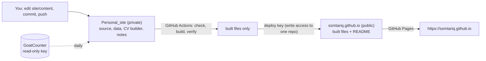

# 08 · Launch guide: go private, test live, then switch

How the pieces fit:

- **`Personal_site` (private).** Holds everything: the site source, your data, the CV builder, these planning notes, and a copy of the old site. Its workflow builds the site.
- **`ssmtariq.github.io` (public).** Only receives the finished files. GitHub Pages serves them at https://ssmtariq.github.io.

Each publish replaces the public repository's contents with one fresh commit: the built pages plus a short README saying the source is private. No data files, templates, scripts, notes, or history are left there.

Nothing changes for visitors until step 7. Steps 1 to 4 take about 20 minutes, and every step is reversible.



## 1. Create the private repository (empty)

On github.com:
1. Click **+ → New repository**.
2. Name it `Personal_site` and choose **Private**.
3. Leave README, .gitignore, and license unticked, then click **Create repository**.

Don't push yet. The secret from step 2 must exist first, or the first run fails.

## 2. Let the private repository publish to the public one

Make a key that can write to `ssmtariq.github.io` and nothing else:

```bash
ssh-keygen -t ed25519 -N "" -C "Personal_site publish" -f ~/personal_site_publish_key
```

1. Open **ssmtariq.github.io → Settings → Deploy keys → Add deploy key**.
   - Title: `Personal_site publish`.
   - Key: the contents of `~/personal_site_publish_key.pub`.
   - Tick **Allow write access**, then click **Add key**.
2. Open **Personal_site → Settings → Secrets and variables → Actions**.
   - Click **New repository secret**. Name: `PAGES_DEPLOY_KEY`. Value: the contents of `~/personal_site_publish_key`, including the `BEGIN` and `END` lines.
   - On the **Variables** tab, click **New repository variable**. Name: `SITE_MODE`. Value: `preview`.
3. Delete the key files: `rm ~/personal_site_publish_key ~/personal_site_publish_key.pub`. GitHub keeps what it needs, and you can make a new pair at any time.

While you're in **ssmtariq.github.io → Settings → Pages**, check the source. It should read **Deploy from a branch · main · / (root)**, as it does today. Leave it.

## 3. Push the private repository and keep the old history

```bash
cd /users/ssmtariq/Personal_site
git remote add origin https://github.com/ssmtariq/Personal_site.git
git push -u origin main

# keep the public repository's old commits in the private repository, as a branch
cd /users/ssmtariq/ssmtariq.github.io
git push https://github.com/ssmtariq/Personal_site.git main:refs/heads/legacy-site-history
```

The first push starts the workflow on its own. It takes about 3 minutes.

## 4. Watch the first publish (preview mode)

1. Open **Personal_site → Actions → Build and publish the site** and wait for the green check.
2. If a step fails, it says why. Nothing is published unless every check before it passes.
3. About a minute later, GitHub Pages serves the result.

## 5. Test it live

| Open | You should see |
| --- | --- |
| https://ssmtariq.github.io/ | Your current site, unchanged. Its résumé link now downloads the new CV (the old PDF showed your phone number and a GPA) |
| https://ssmtariq.github.io/v2/ | The new site. Search engines are told not to index it |
| https://ssmtariq.github.io/v2/?card=show | The new site with the "Let's get in touch" card |
| https://ssmtariq.github.io/v2/cv/Syed_Tariq_CV.pdf | The sanitized CV |
| https://github.com/ssmtariq/ssmtariq.github.io | Only built files and the README, with one commit |

**Try it on your phone and a laptop:**
- the menu and dark mode;
- CV download;
- the email buttons;
- the Scholar, GitHub, and LinkedIn links;
- Dr. Roy's page link (you said you'd check that one yourself).

You can share the `/v2/` link privately, for example with Dr. Roy.

**Caching.** A refresh shows a new publish within about 10 minutes. GitHub's CDN caches pages for up to 10 minutes.

## 6. Turn on the visitor counter (any time)

GoatCounter is open source (EUPL-1.2). Hosting is free for personal sites, and it counts without cookies.

1. Sign up at https://www.goatcounter.com/signup and choose the code `ssmtariq`. Your dashboard is then https://ssmtariq.goatcounter.com.
2. In GoatCounter, click your email at the top right (next to **Settings**) and open the **API** tab, or go to https://ssmtariq.goatcounter.com/user/api. Create a key with only the permission to **read statistics**, and copy it. Don't paste GoatCounter's suggested `<script>` snippet: the build adds its own once `GOATCOUNTER_SITE` is set.
3. Open **Personal_site → Settings → Secrets and variables → Actions** and add:
   - secret `GOATCOUNTER_TOKEN`: the key;
   - variable `GOATCOUNTER_SITE`: `ssmtariq`;
   - variable `STATS_START`: the hour you go live, in UTC, for example `2026-11-01T00:00:00Z`. Visits before it aren't shown publicly.
4. Re-run the workflow (**Actions → Build and publish the site → Run workflow**).

From then on, every page view is counted. The footer shows "At least N visitors from M countries since …" and the map once visits arrive. The numbers refresh daily.

## 7. Go live

When you are happy with `/v2/`:

1. Open **Personal_site → Settings → Secrets and variables → Actions → Variables** and set `SITE_MODE` to `live`.
2. Open **Actions → Build and publish the site → Run workflow**.
3. Set `STATS_START` to the current hour, so the public count starts at launch.

About 4 minutes later:
- https://ssmtariq.github.io/ is the new site.
- https://ssmtariq.github.io/v1/ is the previous site. Search engines are told not to index it, and its defunct Google Analytics tag is removed; nothing else changes.
- `/v2/` redirects to `/`, and `/skeleton/` redirects to `/v1/skeleton/`.
- `/cv.pdf` and `/Resume_of_SSM_TARIQ.pdf` serve the sanitized CV (the old pages' "Resume" link included).

**Rollback.** Set `SITE_MODE` back to `preview` and run the workflow again. The old site returns at `/` in about 4 minutes.

## After launch: everyday updates

| You want to | Do |
| --- | --- |
| Add a paper, talk, award, course, or news item | Edit the file in `site/content/` (recipes in `05_Data_Input_Spec.md`), then commit and push. The site rebuilds itself in about 4 minutes |
| Add photos to "Memories" | Put JPG, PNG, WebP, or AVIF files in `site/content/gallery/`. Alt text and captions go in `site/content/gallery.yaml` (optional) |
| Update the CV | Edit your CV in TTAP_Package, then run `python3 cv/make-web-cv.py` here. Commit the new `site/public/cv/Syed_Tariq_CV.pdf` and push |
| Preview on your machine | With Node 24 installed (04 Section 9): `cd site && npm ci && npm run dev`, then open http://localhost:4321 |
| End the job-market banner | Set `job_market.active: false` in `site/content/profile.yaml` |

**What runs on its own:**
- every push to `main`: content checks, build, the CV privacy check, and the pre-publish checks;
- daily: the visitor numbers;
- weekly: a link check of the live site.

GitHub emails you if a run fails.

**Don't push from `/users/ssmtariq/ssmtariq.github.io` again.** After the first publish, that folder is out of date: the workflow owns the public repository. Delete the folder once step 3 has saved its history.

## What the public can and cannot see

| Public | Private |
| --- | --- |
| The pages, images, and CV a browser downloads (as with any website) | Data files, templates, scripts, build settings, planning notes, screenshots of peer sites, the CV's LaTeX and builder, the old site's source, all history |

Anything a browser shows can still be saved by a visitor; that's true of every website.

**The old commits.** Once the first publish force-pushes, the old commits are no longer on any branch, and the repository has no forks. GitHub can still serve an old commit to someone who already has its exact link, until its periodic cleanup removes it.
